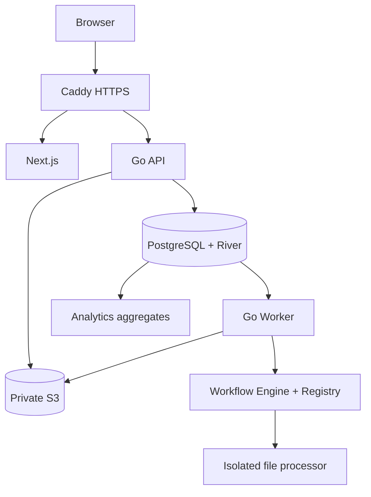

# Архитектура AutoLife

## Стиль и топология
Модульный монолит Go; отдельные процессы API и worker из общего репозитория, PostgreSQL и private object storage. Frontend Next.js, Caddy HTTPS same-origin routing /api/v1. File sandbox запускается через операторский launcher по ADR-001. В будущем изолированный browser worker с egress proxy. Не отдельный микросервис на каждый модуль.



## Границы
core: accounts, sessions, access, quotas, notifications, audit. workflow: definitions, validation, versions, execution state, queue orchestration, registry. files: metadata, authorized artifact I/O, FileFlow actions. watch/inbox/life/integrations/ai — будущие модули с собственными моделями. analytics потребляет события, не зависит от содержимого. Домен и application logic не импортируют HTTP/DB adapters. Межмодульные вызовы через небольшие контракты; не создавать interface для каждой структуры. Composition root регистрирует handlers. Не выдавать воркерам общие секреты провайдеров.

## Структура репозитория
```
backend/cmd/{api,worker}/
backend/internal/{platform,workflow,fileflow,analytics}/
backend/migrations/
frontend/{app,components,features,lib,messages}/
infrastructure/{compose,proxy,sandbox}/
docs/
```
Создавать пакеты по реальной необходимости. Будущие директории не заполнять заглушками.

## Согласованность
PostgreSQL — источник истины. Execution, идемпотентность, квота, входные pin, Transactional Outbox и River InsertTx входят в одну PostgreSQL-транзакцию. Обработка вне DB transaction. CAS/lease fencing при переходах; retry jobs не создают новые executions. S3 не участвует в DB transaction: staging key → проверка → commit metadata → уборка orphan; недоступный output не считается успехом. Lifecycle cleanup не удаляет active references. Events/outbox записываются вместе с committed состоянием. Consumers dedup. MVP: API polling с backoff; SSE позже если оправдано. HTTP error envelope в API.md.

## Масштабирование и эксплуатация
API stateless кроме durable sessions; масштабирование workers по очереди, fair quotas, backpressure. Один VPS допустим для раннего релиза, но это не HA; backup off-host, проверка restore. Health/live/ready, graceful shutdown, metrics, alerting, migrations before rollout, rollback совместимых версий. Секреты через runtime secrets; не в Git. ADR фиксирует изменения схемы, очереди, sandbox, storage, auth и интеграций. Будущие schedule/DAG/human approval добавляются по спецификациям, а не реализуются сразу.

## Согласованные решения

- [ADR-001 — Изоляция файлового обработчика](adr/ADR-001-FILE-SANDBOX.md).
- [ADR-002 — Надёжное выполнение и восстановление](adr/ADR-002-EXECUTION-RECOVERY.md).
- Доменные события пишутся с первой реализации соответствующего домена. Outbox живёт в PostgreSQL, без отдельного брокера. Канонический линейный порядок MVP задаёт массив шагов. Визуальные связи выводятся из порядка, типизированные bindings описывают передачу данных. Условные переходы появляются в TASK-011, fan-out/join в TASK-015.
- Локальный Compose использует тестовую почту. Production-регион, почта, объектное хранилище и провайдер выбираются перед проверками на соответствующей инфраструктуре. Бюджет USD 100 в месяц — ориентир планирования. Подключение платных сервисов, создание внешних аккаунтов и production deploy требуют отдельного разрешения.
- [ADR-003 — Аккаунты, сессии и журнал удаления](adr/ADR-003-ACCOUNT-SESSIONS.md).

## Расширенная конвертация FileFlow

Модульный монолит сохраняет текущие API, worker и операторский launcher. Go-адаптеры FileFlow регистрируются через Action Registry и работают в существующем Workflow Engine/River. Реестр публикует пары форматов и типизированные параметры из проверенных возможностей поставляемых профилей; добавление пары не меняет алгоритм планирования. Выключенные пары отклоняются при принятии и повторно перед запуском.

Worker проверяет owner и pin, резервирует лимиты, передаёт только выделенные входы, принимает ограниченный результат и публикует через staging и fencing ADR-002. Launcher ADR-001 использует отдельные allowlisted профили изображений, PDF, Office/TXT, HTML, таблиц и будущих медиа. Аргументы и идентификатор профиля выбираются сервером. Пакет обрабатывается с ограниченным параллелизмом в рамках шага, последующие действия используют упорядоченные refs. Один набор артефактов публикуется при полном успехе шага. Быстрые операции — одношаговые executions, очередь и восстановление общие.
